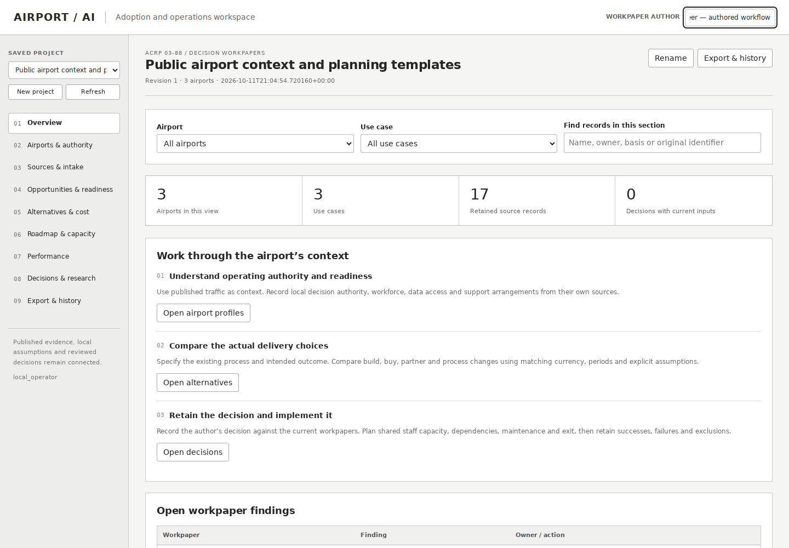

# Airport assessment and implementation workbench

A local, editable workspace for airport AI adoption research: original source files → airport and authority context → opportunity and readiness assessments → build/buy/partner/process alternatives → reviewed decisions → implementation and measurement workpapers.



## Install and open

Download [airport_assessment_workbench-0.1.0-py3-none-any.whl](airport_assessment_workbench-0.1.0-py3-none-any.whl?raw=true). The 772,648-byte package contains the application source, browser interface, public reference materials and two separate example projects.

Use Python 3.10 or later. Installation needs no additional package downloads:

```sh
python3 -m venv airport-env
airport-env/bin/python -m pip install --no-index --no-deps ./airport_assessment_workbench-0.1.0-py3-none-any.whl
airport-env/bin/airport-workbench --workspace ./airport-workspace --demo --port 8771
```

On Windows, use `airport-env\Scripts\python.exe` and `airport-env\Scripts\airport-workbench.exe` for the last two commands. Open **http://127.0.0.1:8771**. Start the same command to reopen saved work. The local actor name records the operator's supplied label.

To load the separate calculator and decision example, use `--authored-demo` with the same workspace. The public context project contains published FAA and airport material; the authored planning project supplies editable example costs, capacity and observations.

## Work through an assessment

- Retain original CSV, JSON, XLSX and reference documents with source metadata. Preview the actual columns and select explicit field mappings or the FAA enplanement mapping.
- Keep airport owners, operators and decision authority distinct. Connect each use case with source-backed readiness, risk and responsibility workpapers.
- Compare delivery alternatives using explicit cost periods, currency, discount assumptions, preference criteria and shared allocations.
- Save a decision together with its complete reviewed inputs. Subsequent source or workpaper changes leave the original decision available for comparison and later review.
- Plan dependencies, period-specific staff capacity, maintenance and exit responsibilities across the project.
- Measure count, mean or rate using declared cohorts, observation windows, eligibility and exclusions.
- Export editable project, airport or use-case reports and an implementation memorandum. Choose original attachments explicitly for each recipient.
- Export a complete private continuation archive and restore it into a fresh local workspace to continue editing.

The application uses the Python standard library and SQLite. It runs on loopback with local-origin checks; the operator controls its workspace and original files. See the [operator guide](OPERATOR_GUIDE.md) for complete import, calculation, export, recovery and API instructions.

## Sources and scope

The included FAA CY2025 workbook retains **1,676 airport rows**, six publisher footer rows and one blank source row. The public project selects **DEN, SYR and HPN**, with four distinct published owner/operator records. Sixteen reference entries plus their source manifest make seventeen retained originals.

The project follows the interactive-tool direction of [ACRP 03-88](https://rip.trb.org/View/2772553). Published traffic and governance context remain distinct from authored planning inputs and from locally supplied airport observations. Participating research teams provide their own methods, airport findings, judgments and research personnel.

## Package identity

Version: **0.1.0**  
Bytes: **772,648**  
SHA-256: `38c9fbdbaf76b51dc0e91c1625ff8624f98241017466d99160b70ea4d633ce30`

The installer was built from the completed application, installed without network dependencies, and used to restore the saved assessment with exact original source bytes and unchanged calculations. Reopening the saved project preserved its reviewed inputs and workpapers.

Application code: [MIT](LICENSE). Reference publications retain their original rights and notices; see [SOURCE-NOTICES.md](SOURCE-NOTICES.md).
